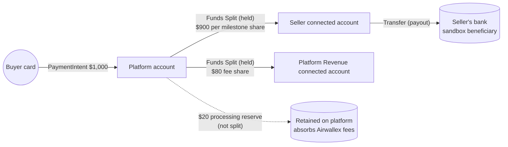

# 01 — Product Overview

## The brief

> Payment acceptance, Funds Split, delayed release, refunds, Connected Accounts, and webhook-driven status updates will be powered by Airwallex, enabling milestone payments to be held and released only after buyer approval.

In one sentence: **the seller sends an offer, the buyer accepts and pays, the seller delivers milestones, the buyer approves each one, and money reaches the seller milestone by milestone.**

## Goals of the demo

1. Show a believable freelance escrow experience end to end in under 5 minutes.
2. Exercise each Airwallex capability named in the brief with **real sandbox API calls**, with no mocked money movement:
   - Payment acceptance (PaymentIntent + Drop-in element)
   - Funds Split (to seller + to a platform revenue account)
   - Delayed release (`auto_release: false` + Release endpoint)
   - Refunds (Funds Split Reversal + Refund)
   - Connected Accounts (one per user, with wallet balances)
   - Webhook-driven status updates
3. Zero-friction access: seeded accounts and a **"Continue as guest"** button, so anyone can try it without signing up.
4. A codebase that works as a **reference/base for other builders and LLMs**, with explicit comments marking demo-only shortcuts.

## Non-goals

- Production security, compliance, KYC, or fraud controls.
- Real file uploads (deliverables are **links only**).
- Disputes/chargebacks, arbitration, or auto-approval timers (documented as future work).
- Multi-currency pricing. The demo uses a single currency (`USD` by default).
- Email delivery (no verification emails, no notifications).
- Messaging/chat between users.

## Personas

| Persona | What they do in the demo |
| --- | --- |
| **Seller (freelancer)** | Creates an offer with milestones, sends it to a buyer, submits delivery links, and watches funds arrive in their Airwallex wallet. |
| **Buyer (client)** | Sees incoming offers on the home page, accepts one, pays with a sandbox card (or wallet balance), reviews deliveries, and approves or cancels milestones. |
| **Demo viewer** | Clicks "Continue as guest", lands in a pre-populated account, and explores. Can open the **Airwallex activity panel** to see the exact API calls and webhooks behind each action. |
| **Platform operator** | A demo-only `/platform` page showing the platform account balance, the Revenue account balance, and recent webhooks, so the fee split is visible. |

Any user can be both buyer and seller. Roles are per offer, not per account.

## Core flows (summary)

Full step-by-step detail is in [05-user-flows.md](./05-user-flows.md).

1. **Sign up / log in / guest.** Email + password (unverified). Guest assigns a random seeded account from the guest pool.
2. **Account provisioning.** Every new user gets an Airwallex connected account, a welcome wallet credit, and a **welcome offer** from a random seed seller, so their home page isn't empty.
3. **Create and send an offer (seller).** Title, description, buyer (pick a user), milestones (title, description, amount, optional due date). The UI shows a live fee breakdown.
4. **Accept and pay (buyer).** Buyer reviews the offer, clicks Accept, and pays the full total with a sandbox card via the Drop-in element, or from their wallet balance.
5. **Funds held.** Webhook `payment_intent.succeeded` triggers Funds Split creation with delayed release. All milestones show **Funded — held in escrow**.
6. **Deliver a milestone (seller).** Seller submits one or more links plus a note.
7. **Approve or request changes (buyer).** Approve triggers the release of that milestone's splits. Request changes sends it back to the seller.
8. **Seller gets paid.** Webhook `funds_split.settled` marks the milestone **Paid**, and the seller's wallet balance increases.
9. **Cancel / refund.** Buyer or seller can cancel an unreleased milestone (or the whole remaining contract). Splits are reversed and the buyer is refunded to their card.
10. **Wallet.** Every user can see their balances and transaction history, withdraw to a sandbox bank beneficiary, and (optionally) send money to another user.

## Money-flow story (what the demo proves)

The numbers above assume `PLATFORM_FEE_PERCENT=10` and `PROCESSING_RESERVE_PERCENT=2`. See the fee math in [03-airwallex-integration.md](./03-airwallex-integration.md#platform-fee-model).

## Success criteria for the demo

- A guest can go from landing page to "milestone paid, seller balance increased" in under 5 minutes.
- Every state shown in the UI is backed by a real Airwallex object ID, visible in the activity panel.
- Re-running the seed script produces a clean, working demo environment.
- Grepping for `DEMO-ONLY` lists every shortcut that must change for production.
