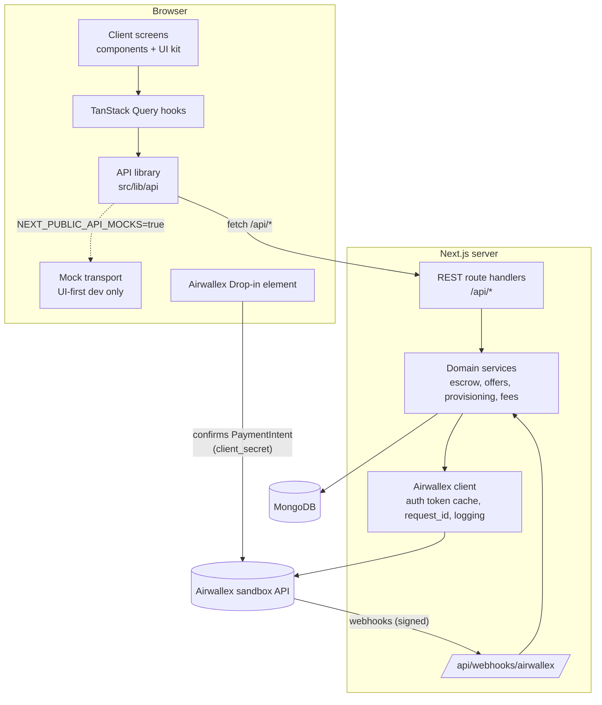

# 02 — Architecture

## Tech stack

| Layer | Choice | Notes |
| --- | --- | --- |
| Framework | **Next.js (App Router), TypeScript** | REST route handlers (`src/app/api`) for everything the UI calls, plus the webhook. Pages are thin server components rendering client "screens". No server actions for data. |
| Client data | **TanStack Query** over a typed **API library** (`src/lib/api`) | Swappable transport: real `fetch` or an in-memory **mock transport** for UI-first development. See [14-frontend-architecture.md](./14-frontend-architecture.md). |
| Client state | No global store | Server state in the Query cache, URL state in search params, forms in `react-hook-form`, local UI in `useState`. |
| Contracts | `src/contracts` (zod schemas + DTO types) | Shared by route handlers, API library, and mocks. Spec: [06-api-routes.md](./06-api-routes.md). |
| Database | **MongoDB** via **Mongoose** | MongoDB Atlas free tier or local `mongod`. |
| Payments / accounts | **Airwallex sandbox** (`https://api.sandbox.airwallex.com`) | Called server-side only, with a thin typed client (`src/lib/airwallex`). |
| Checkout UI | **`@airwallex/components-sdk`** (Airwallex.js), Drop-in element | `init({ env: 'demo', enabledElements: ['payments'] })`. Do **not** use the legacy `airwallex-payment-elements` package. |
| Auth | Email + password (bcrypt) with a signed, httpOnly session cookie (`jose` JWT) | No email verification (demo-only). |
| Validation | `zod` | Same schemas validate forms (client), mock handlers, and route handlers. |
| Forms | `react-hook-form` + `@hookform/resolvers/zod` | |
| Styling / UI kit | Tailwind CSS v4 + **shadcn/ui** (Radix), `lucide-react`, `sonner` toasts | Bare-bones and clean. Tokens and inventory in [09-ui-pages.md](./09-ui-pages.md). |
| Scripts | `tsx` | `scripts/seed.ts`, `scripts/reset.ts`, `scripts/spike/*.ts`. |
| Redis | **Not used** | See [Why no Redis](#why-no-redis). |

## High-level diagram



Principles:

- **All Airwallex calls are server-side.** The browser only ever receives a PaymentIntent `id` and `client_secret`.
- **Domain services own business rules** (`src/services`). Route handlers are thin: auth check, then validate, then call a service, then map to a DTO.
- **One contract, three implementations.** `src/contracts` defines DTOs and inputs; route handlers, the mock transport, and the API library all conform to it. The UI never depends on Mongo documents directly.
- **The server decides what the viewer can do.** DTOs include `allowedActions`, computed by a pure `permissions.ts` shared with the mocks.
- **Webhooks are the source of truth** for money state. UI actions only *request* transitions (for example, "approve" moves a milestone to `RELEASING`). The webhook confirms it (`RELEASED`).
- **Every Airwallex request/response and every webhook is logged** to MongoDB (`airwallex_logs`, `webhook_events`) and surfaced in the activity panel. This is the most useful demo feature for technical audiences.

## Proposed folder layout

```text
.
├── public/                       # static files, served from / (images, downloads)
├── docs/                         # this documentation
├── scripts/
│   ├── seed.ts                   # idempotent seed (accounts, users, offers)
│   ├── reset.ts                  # wipe Mongo demo data (does NOT delete Airwallex accounts)
│   └── spike/                    # B0 sandbox experiments (see 12-implementation-plan.md)
├── src/
│   ├── app/
│   │   ├── providers.tsx         # QueryClientProvider, Toaster, MockDevtools (mock mode)
│   │   ├── (public)/login/page.tsx
│   │   ├── (public)/signup/page.tsx
│   │   ├── (app)/page.tsx        # home: incoming offers + my contracts
│   │   ├── (app)/welcome/page.tsx
│   │   ├── (app)/offers/new/page.tsx
│   │   ├── (app)/offers/[id]/page.tsx
│   │   ├── (app)/offers/[id]/pay/page.tsx
│   │   ├── (app)/offers/[id]/pay/return/page.tsx
│   │   ├── (app)/wallet/page.tsx
│   │   ├── (app)/platform/page.tsx   # DEMO-ONLY operator view
│   │   ├── dev/ui-kit/page.tsx   # DEMO-ONLY component showcase
│   │   └── api/                  # REST routes, full list in docs/06
│   │       ├── auth/..., me/..., config/public, users/search
│   │       ├── offers/..., offers/[id]/milestones/[mid]/..., offers/[id]/payments/...
│   │       ├── wallet/..., platform/...
│   │       └── webhooks/airwallex/route.ts
│   ├── contracts/                # zod schemas + DTO types + permissions.ts (shared client/server/mock)
│   ├── hooks/                    # TanStack Query hooks + queryKeys.ts
│   ├── components/
│   │   ├── ui/                   # UI kit primitives (shadcn/ui-based)
│   │   ├── domain/               # Money, StatusPill, FeeBreakdown, MilestoneCard, ...
│   │   ├── layout/               # AppShell, TopBar, DemoBanner, PageHeader
│   │   ├── screens/              # one client screen per page
│   │   └── providers/
│   ├── server/                   # server-only: route() wrapper, DTO mappers
│   ├── lib/
│   │   ├── api/                  # API library (client) + mock/ transport
│   │   ├── utils.ts              # cn() and small helpers
│   │   ├── airwallex/
│   │   │   ├── client.ts         # fetch wrapper, token cache, logging, errors
│   │   │   ├── accounts.ts       # create / submit / simulate status / retrieve
│   │   │   ├── payments.ts       # payment intents, customers
│   │   │   ├── fundsSplits.ts    # create / release / retrieve / reversals
│   │   │   ├── refunds.ts
│   │   │   ├── wallet.ts         # balances, balance history, charges, CA transfers
│   │   │   ├── payouts.ts        # beneficiaries, transfers
│   │   │   ├── webhooks.ts       # signature verification + event typing
│   │   │   └── requestIds.ts     # deterministic request_id builders
│   │   ├── db.ts                 # cached Mongoose connection
│   │   ├── session.ts            # cookie session helpers
│   │   ├── money.ts              # minor-unit helpers, formatting
│   │   ├── config.ts             # zod-validated server env
│   │   └── config.public.ts      # zod-validated NEXT_PUBLIC_* env
│   ├── models/                   # Mongoose schemas (see 04-data-model.md)
│   ├── services/
│   │   ├── provisioning.ts       # user -> connected account -> welcome credit -> welcome offer
│   │   ├── offers.ts             # create/send/decline/withdraw
│   │   ├── funding.ts            # card rail + wallet rail funding
│   │   ├── escrow.ts             # create held splits, release, reverse/refund
│   │   ├── fees.ts               # fee breakdown math (pure, unit-tested)
│   │   └── webhookHandlers.ts    # event name -> handler
│   └── proxy.ts                  # real mode: redirect to /login without a session cookie (Next.js 16; was middleware)
└── .env.example
```

## Environment variables

`NEXT_PUBLIC_*` values are validated with zod in `src/lib/config.public.ts` (safe to import from client code). Server secrets are validated at boot in `src/lib/config.ts` (`src/instrumentation.ts` calls it when the Node server starts). Missing server values should fail loudly. `NEXT_PUBLIC_API_MOCKS=true` is refused when `NODE_ENV=production` unless `ALLOW_MOCKS_IN_PROD=true`.

| Variable | Example | Purpose |
| --- | --- | --- |
| `APP_URL` | `http://localhost:3000` | Used for return URLs. |
| `MONGODB_URI` | `mongodb://localhost:27017/awx-escrow` | Database. |
| `SESSION_SECRET` | 32+ random chars | Signs the session JWT. |
| `AIRWALLEX_API_BASE` | `https://api.sandbox.airwallex.com` | Sandbox base URL. Production is `https://api.airwallex.com`. |
| `AIRWALLEX_CLIENT_ID` | from sandbox web app | `x-client-id` header for login. |
| `AIRWALLEX_API_KEY` | from sandbox web app | `x-api-key` header for login. **Server only.** |
| `AIRWALLEX_WEBHOOK_SECRET` | from sandbox web app webhook settings | HMAC key for `x-signature`. |
| `AIRWALLEX_PLATFORM_ACCOUNT_ID` | `acct_...` | Our platform account ID (for display and sanity checks). |
| `NEXT_PUBLIC_AIRWALLEX_ENV` | `demo` | Airwallex.js `init({ env })`. `demo` = sandbox. |
| `NEXT_PUBLIC_API_MOCKS` | `true` | UI uses the in-memory mock transport instead of `/api/*` (UI-first development). Refused in production builds unless `ALLOW_MOCKS_IN_PROD=true`. |
| `ALLOW_MOCKS_IN_PROD` | `false` | Explicit opt-in for a mock-backed UI preview deployment. |
| `NEXT_PUBLIC_ENABLE_UI_KIT` | `false` | Expose `/dev/ui-kit` in production builds (always on in development). |
| `DEMO_CURRENCY` | `USD` | Single currency for the demo. |
| `PLATFORM_FEE_PERCENT` | `10` | Total fee taken from each milestone. |
| `PROCESSING_RESERVE_PERCENT` | `2` | Part of the fee left unsplit on the platform account to absorb Airwallex processing fees. Must be `<= PLATFORM_FEE_PERCENT`. |
| `WELCOME_CREDIT_AMOUNT` | `5000` | Wallet credit (CA Transfer from platform) given to every new account. |
| `ENABLE_WALLET_RAIL` | `true` | Show "Pay from wallet" at checkout. |
| `SEQUENTIAL_MILESTONES` | `false` | When `true`, a seller can deliver a milestone only after the previous one is `PAID`. |
| `SEED_PASSWORD` | `demo1234` | Password for all seeded users. |
| `DEMO_ADMIN_KEY` | random | Optional gate for `/platform` and destructive admin routes. |

`.env.example` should include all of these with comments. Mark `AIRWALLEX_API_KEY` and `AIRWALLEX_WEBHOOK_SECRET` as secrets.

## Airwallex client design (`src/lib/airwallex/client.ts`)

Responsibilities:

1. **Authentication.** `POST /api/v1/authentication/login` with `x-client-id` and `x-api-key` returns `{ token, expires_at }`.
   - Cache the token in module memory and refresh **based on `expires_at`** (minus a 60s skew), not a hard-coded lifetime. Airwallex's AI-agent notes explicitly say to read `expires_at`.
   - On a `401` from any call, clear the cache, re-login once, and retry once.
   - `// DEMO-ONLY:` in-memory cache means each serverless instance logs in separately. That's fine at demo traffic. `// PROD:` use a shared cache with a lock, and watch login rate limits.
2. **`request<T>(method, path, { body, onBehalfOf, requestId })`**
   - Adds `Authorization: Bearer`, `Content-Type`, and `x-on-behalf-of` when acting for a connected account.
   - Injects `request_id` into POST bodies when not provided. **Prefer deterministic request IDs** (see below).
   - Optionally pins the API version via the `x-api-version` header. Verify the header name and pick the current version in the spike; see [13-open-questions-and-risks.md](./13-open-questions-and-risks.md).
3. **Logging.** Writes an `airwallex_logs` document per call: method, path, on-behalf-of, request body (redacted), status, response body (trimmed), duration, and related `offerId`/`milestoneId`. Powers the activity panel.
4. **Errors.** Throws a typed `AirwallexError { status, code, message, traceId }`. Treat `duplicate_request` as "already done": retrieve the existing object instead of failing.

### Deterministic `request_id`s (idempotency)

Airwallex requires a unique `request_id` (max 64 chars) on create calls. Deriving it from our own IDs makes retries safe and makes webhook replays harmless:

| Operation | `request_id` pattern |
| --- | --- |
| Create PaymentIntent for an offer (attempt N) | `pi:{offerId}:{attempt}` |
| Cancel an unused PaymentIntent when paying from the wallet | `picancel:{paymentId}` |
| Create seller split for a milestone | `fs:{milestoneId}:seller` |
| Create revenue split for a milestone | `fs:{milestoneId}:rev` |
| Release split | `fsr:{splitId}` |
| Reverse split | `fsrev:{splitId}` |
| Refund milestone | `rf:{milestoneId}` |
| Charge (wallet rail funding) | `ch:{offerId}` |
| CA transfer to seller (wallet rail release) | `cat:{milestoneId}:seller` |
| Welcome credit | `welcome:{userId}` |
| Seed wallet top-up | `seedtopup:{userId}:{seedVersion}` |
| CA transfer to revenue (wallet rail release) | `cat:{milestoneId}:rev` |
| CA transfer refund to buyer (wallet rail) | `cat:{milestoneId}:refund` |
| Send to another user (charge, then transfer, then return) | `sch:{nonce}`, `sxf:{nonce}`, `srt:{nonce}` |
| Withdraw to bank | `wd:{nonce}` |

Offer and user ids are 24-character Mongo ObjectIds. Send and withdrawal ids append a 32-character nonce because each movement is a new transfer, so a double-click can create two payouts. Scale charges and connected-account transfers reject ids longer than 50 characters; payout transfer ids allow 64.

## Money representation

- Airwallex APIs take **decimal major units** (`12.50` means $12.50). They are **not** cents. Never multiply by 100 when sending. (Some Funds Split fields are typed as strings, for example `"amount": "90.00"`.)
- Internally, **store integer minor units** (`amountMinor: 1250`) to avoid floating-point errors. Convert only at the Airwallex boundary with `toAwxAmount(minor, currency)` / `fromAwxAmount(value, currency)` in `src/lib/money.ts`, using currency precision (USD = 2).
- Fee math is done in minor units with explicit rounding rules (see [03](./03-airwallex-integration.md#platform-fee-model)).

## Why no Redis

Nothing in the design needs it:

- **Token cache:** in-memory per instance is fine for a demo.
- **Idempotency:** deterministic `request_id`s plus a unique index on `webhook_events.eventId` in Mongo.
- **Background jobs:** none are required. Webhooks arrive over HTTP. Provisioning runs inline during sign-up (a few seconds), with a resumable state machine stored on the user document.
- **Sessions:** stateless signed cookies.

If we later add auto-approval timers or retry queues, the first choice should still be a Mongo-backed job collection or a hosted cron (for example Vercel Cron) before introducing Redis.

## Deployment

- **Replit** (Autoscale by default, Reserved VM when webhooks must stay up) plus **MongoDB Atlas**. See [11 §3](./11-setup-and-runbook.md#3-deploying-the-demo-replit).
- The webhook URL `https://<host>/api/webhooks/airwallex` is registered in the Airwallex sandbox web app. Use the published `*.replit.app` host, not the editor URL.
- For local development, expose localhost with a tunnel (`cloudflared` or `ngrok`) or rely on the **sync fallback** (see [07-webhooks.md](./07-webhooks.md#local-development)).
- Webhook route must run on the **Node.js runtime** (`export const runtime = 'nodejs'`) so we can read the raw body and use `crypto`.
