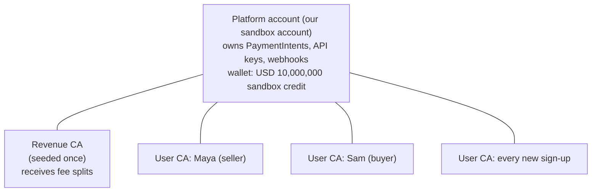
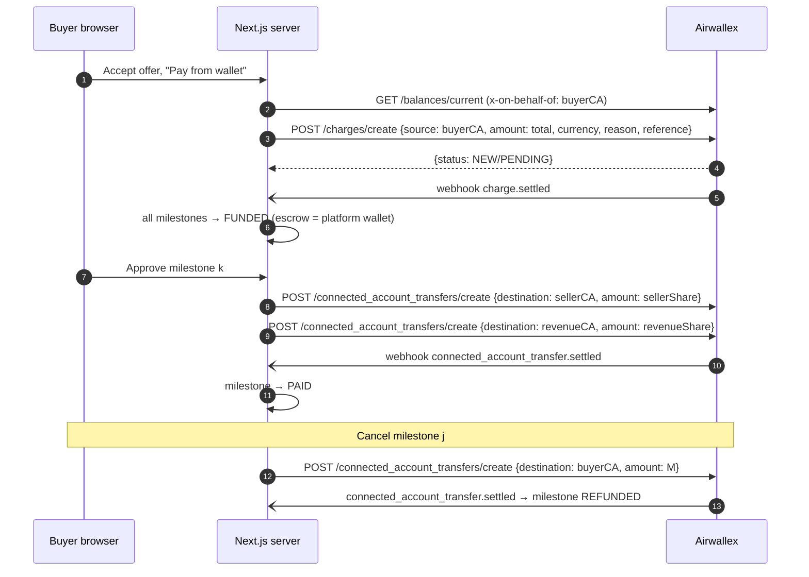

# 03 — Airwallex Integration

This is the core document. It explains which Airwallex products we use, how money moves, how the fee is split, and exactly which endpoints are called at each step.

> **Verify before building.** Several behaviours below come from reading the docs, not from running them. They are listed in [13-open-questions-and-risks.md](./13-open-questions-and-risks.md) and must be confirmed in the **B0 sandbox spike** ([12-implementation-plan.md](./12-implementation-plan.md)).

## 1. Account topology



- **One platform account.** A self-serve sandbox account comes pre-activated, with Payments onboarding approved, Hosted Payment Page enabled, cards enabled, and wallets pre-funded (10,000,000 each in USD, EUR, GBP, and CNY). Settlement is `BACKTOBACK` with a **0-day delay**. Source: [Sandbox settings](https://www.airwallex.com/docs/developer-tools/sandbox-environment/sandbox-settings.md).
- **Connected accounts must be enabled on the platform account.** The quickstart requires "an Airwallex platform account with connected accounts capabilities enabled", which means contacting Airwallex. Funds Split also requires the Payments-for-Platforms setup. **This is the main external dependency.** See [11-setup-and-runbook.md](./11-setup-and-runbook.md).
- **One connected account (CA) per user**, type `INDIVIDUAL`. Created via `POST /api/v1/accounts/create`, submitted, then force-activated with the sandbox simulation endpoint.
- **One Revenue CA** (seeded, `BUSINESS` or `INDIVIDUAL`) that receives the platform-fee share of every split, to make "funds split to a known account" visible.

### Account tier

Connected accounts come in three tiers: **ledger**, **withdrawal**, and **full**. Tier is decided by platform configuration, not per request. See [Account types](https://www.airwallex.com/docs/connected-accounts/about/account-types.md).

- Funds Split destinations "have to pass KYC". In sandbox, we satisfy this with the forced `ACTIVE` status.
- For this demo, users don't need to accept payments themselves (the **platform** is Merchant of Record), so any tier that can **hold funds** and **pay out to own bank** is enough. Ask Airwallex for whichever tier they enable for sandbox platforms. Document the answer in the setup doc.

## 2. Payment model: "Collect payments directly"

Airwallex's gateway for platforms has two models ([overview](https://www.airwallex.com/docs/payments-for-platforms/airwallex-gateway/airwallex-payment-gateway-overview.md)):

| | Collect payments directly (**we use this**) | Collect on behalf of connected accounts |
| --- | --- | --- |
| Payment owned by | Platform | Connected account |
| Principal received by | Platform | Connected account |
| Split direction | Platform → connected account(s) | Connected account → platform |
| API indicator | Body param `connected_account_id` | Header `x-on-behalf-of` |
| Typical use | Marketplaces / freelancer platforms | SaaS |

We use **Collect payments directly** because it fits a marketplace: the platform is Merchant of Record, it owns refunds and disputes, and it disburses to sellers via Funds Split. It also means sellers don't need payment-acceptance capability (simpler onboarding).

## 3. The two funding rails

| | **Card rail** (primary) | **Wallet rail** (secondary) |
| --- | --- | --- |
| Buyer pays with | Sandbox test card via Drop-in element | Their CA wallet balance |
| Funding call | PaymentIntent (+ Drop-in confirm) | `POST /api/v1/charges/create` (buyer CA → platform) |
| Where escrow sits | Held Funds Splits (`auto_release: false`) | Platform wallet balance (our DB tracks it per milestone) |
| Release call | `POST /api/v1/pa/funds_splits/{id}/release` | `POST /api/v1/connected_account_transfers/create` (platform → seller CA) |
| Refund call | Funds Split Reversal + `POST /api/v1/pa/refunds/create` | CA Transfer back to buyer CA |
| Showcases | Payment acceptance, Funds Split, delayed release, Refunds | Connected accounts, Charges, CA Transfers |
| Needs browser | Yes | No (fully server-side, which is why **seed data uses this rail**) |

Both rails produce the same user-visible outcome: seller's CA wallet balance increases when a milestone is approved.

The card rail is what the brief describes, so it's the default. The wallet rail answers "every user's financial account is used to make payments". It's also the **fallback** if held Funds Splits turn out not to support long holds in sandbox (see risks).

## 4. Platform fee model

Every milestone amount `M` is divided three ways:

| Share | Formula (minor units) | Destination |
| --- | --- | --- |
| Seller share | `M − fee` | Seller CA (Funds Split / CA Transfer) |
| Revenue share | `fee − reserve` | Revenue CA (Funds Split / CA Transfer) |
| Processing reserve | `reserve` | Stays on the platform account (not split) |

Where:

```text
fee     = roundHalfUp(M * PLATFORM_FEE_PERCENT / 100)
reserve = roundHalfUp(M * PROCESSING_RESERVE_PERCENT / 100)
seller  = M - fee
revenue = fee - reserve
assert seller + revenue + reserve == M
```

Example with defaults (10% fee, 2% reserve) on a $1,000.00 milestone: seller **$900.00**, revenue **$80.00**, reserve **$20.00**.

Why a reserve? In the "collect directly" model, Airwallex nets its processing fees from the **platform's** remaining share. The official example shows 100 GBP collected, 90 split to the seller, and the platform receiving 5 after 5 in fees. If we split 100% of the payment away, the platform's share would be negative. The reserve keeps the platform's remainder positive. Set `PROCESSING_RESERVE_PERCENT=0` to send the entire fee to the Revenue CA if the spike shows that works.

Rules:

- The fee is **deducted from the seller** (buyer pays exactly the offer total). This is simplest to explain in a demo.
- Validation: minimum milestone amount **$10.00** so rounding never yields a zero or negative share.
- `src/services/fees.ts` is a pure function `breakdown(amountMinor, config) → { sellerMinor, revenueMinor, reserveMinor }`, with unit tests.
- The breakdown is **snapshotted onto each milestone** when the offer is sent, so later config changes don't alter existing offers.
- Wallet rail uses the same breakdown for consistency (no processing fee there, so the reserve is simply platform profit).

## 5. Card rail: sequence

```mermaid
sequenceDiagram
  autonumber
  participant B as Buyer browser
  participant S as Next.js server
  participant DB as MongoDB
  participant AX as Airwallex

  B->>S: Accept offer (POST /api/offers/:id/payments/card)
  S->>AX: POST /pa/payment_intents/create {amount: total, currency, merchant_order_id: offerId,<br/>connected_account_id: sellerCA, metadata, return_url}
  AX-->>S: {id: int_..., client_secret}
  S->>DB: payment {PENDING, paymentIntentId}; offer → AWAITING_PAYMENT
  S-->>B: intent_id + client_secret
  B->>AX: Drop-in confirms with test card 4035 5010 0000 0008
  AX-->>B: success event
  B->>S: GET /offers/:id/pay/return (retrieves PI as a fallback)
  AX-)S: webhook payment_intent.succeeded
  S->>DB: payment → SUCCEEDED (idempotent)
  loop each milestone
    S->>AX: POST /pa/funds_splits/create {source_id: int_..., source_type: PAYMENT_INTENT,<br/>amount: sellerShare, destination: sellerCA, auto_release: false}
    S->>AX: POST /pa/funds_splits/create {... amount: revenueShare, destination: revenueCA, auto_release: false}
    S->>DB: milestone → FUNDED, store split IDs
  end
  S->>DB: offer → ACTIVE

  Note over B,AX: Later: seller submits delivery, buyer approves milestone k
  B->>S: Approve milestone k
  S->>AX: POST /pa/funds_splits/{sellerSplit}/release
  S->>AX: POST /pa/funds_splits/{revenueSplit}/release
  S->>DB: milestone → RELEASING
  AX-)S: webhook funds_split.released / funds_split.settled
  S->>DB: split → SETTLED; when all splits settled → milestone PAID
```

### Important timing constraint

"A Funds Split can be created only after the Payment Intent succeeds **and before funds settlement**." ([Create a Funds Split](https://www.airwallex.com/docs/api/payments/funds_splits/create.md)). The sandbox default settlement is back-to-back with 0-day delay, so:

- Create splits **immediately** when `payment_intent.succeeded` arrives, or from the return-page fallback, whichever comes first. Both call the same idempotent `escrow.createHeldSplits(offerId)`.
- **Do not** use `funds_split_data` on PaymentIntent create. Splits created that way are **automatically released** after success, which defeats the escrow.
- Whether a held (`auto_release: false`) split can stay held for days or weeks is **unverified**. Spike this first.

### Card rail: refund / cancel

For a milestone that's funded but not released (`FUNDED`, `SUBMITTED`, `CHANGES_REQUESTED`):

1. For each of the milestone's splits, `POST /api/v1/pa/funds_split_reversals/create { funds_split_id, amount: splitAmount }`. This returns the split funds to the platform.
   - Verify in the spike whether a reversal is required (or even allowed) for a split still in `CREATED` status. If Airwallex refuses, record the split as abandoned and rely on the refund alone. See risks.
2. `POST /api/v1/pa/refunds/create { payment_intent_id, amount: M, reason }`, a partial refund for exactly the milestone amount.
3. `refund.accepted` / `refund.settled` webhooks mark the milestone `REFUNDED`.

Refunds are paid from the platform's refundable funds (unsettled funds or available balance in that currency). The sandbox platform wallet is pre-funded, so this won't fail for lack of funds. Airwallex processing fees are generally **not** returned on refund. That small loss comes out of the platform's balance. See [Refunds](https://www.airwallex.com/docs/payments/payment-operations/manage-payments/refunds.md).

Refunds after release (seller already paid) are **out of scope**. In production this would be a Funds Split Reversal on a settled split, which pulls money back from the seller, followed by a refund. That's a dispute-resolution feature.

## 6. Wallet rail: sequence



Notes:

- Charges and CA Transfers are ledger moves inside Airwallex and settle quickly. They may be held by transaction monitoring (`PENDING` → `SETTLED`, or `SUSPENDED`/`FAILED`). Statuses: `NEW`, `PENDING`, `SETTLED`, `SUSPENDED`, `FAILED`. See [statuses](https://www.airwallex.com/docs/connected-accounts/move-funds/charges-and-ca-transfers-statuses.md).
- Required fields for both: `request_id`, `amount`, `currency`, `reason`, `reference`, plus `source` (charges) or `destination` (transfers).
- Check the buyer's `available_amount` before charging, and show a clear "insufficient balance" message.

## 7. Connected account provisioning

Run for every seed user, the Revenue account, and every new sign-up. Each step is recorded on the user doc (`airwallex.provisioning.step`) so it can resume after a failure.

| Step | Call | Notes |
| --- | --- | --- |
| 1. Create | `POST /api/v1/accounts/create` | `account_details.legal_entity_type: INDIVIDUAL`, `individual_details` (name, DOB, nationality, `residential_address`), `customer_agreements { agreed_to_data_usage: true, agreed_to_terms_and_conditions: true }`, `primary_contact.email`. Returns `acct_...`, status `CREATED`. |
| 2. Submit | `POST /api/v1/accounts/{id}/submit` | Moves to `SUBMITTED`. Mandatory fields depend on country. Discover the minimal sandbox payload in the spike. |
| 3. Activate | `POST /api/v1/simulation/accounts/{id}/update_status { next_status: "ACTIVE", force: true }` | **Sandbox only.** Skips KYC review. |
| 4. Confirm | `GET /api/v1/accounts/{id}` or webhook `account.active` | Store status. |
| 5. Welcome credit | `POST /api/v1/connected_account_transfers/create { destination: acct, amount: WELCOME_CREDIT_AMOUNT }` | From the platform's pre-funded wallet. Gives the user a wallet balance for the wallet rail. |
| 6. Welcome offer | (internal) | Create an offer from a random seed seller to this user. See [08-seeding.md](./08-seeding.md). |

`// DEMO-ONLY:` We agree to Airwallex terms on the user's behalf and use **fixture identity data** (for example DOB `1990-01-01`, a fixed address). `// PROD:` Collect real identity data via [Hosted Onboarding](https://www.airwallex.com/docs/connected-accounts/onboarding/kyc-and-onboarding/hosted-onboarding.md) or the [Embedded KYC component](https://www.airwallex.com/docs/connected-accounts/onboarding/kyc-and-onboarding/embedded-kyc-component.md), capture the user's own consent to terms, and handle RFIs.

## 8. Wallet features (profile / wallet page)

| Feature | Call(s) | Scope |
| --- | --- | --- |
| Balances | `GET /api/v1/balances/current` with `x-on-behalf-of: {userCA}` | Core |
| Transaction history | `GET /api/v1/balances/history` with `x-on-behalf-of` | Core |
| Escrow summary | Our DB: sum of `FUNDED`/`SUBMITTED` milestones as buyer ("held") and as seller ("incoming") | Core |
| Withdraw to bank | Create beneficiary + `POST /api/v1/transfers/create` with `x-on-behalf-of` | Stretch. Uses sandbox test bank details. See [Create a transfer](https://www.airwallex.com/docs/payments-for-platforms/pay-out-funds/create-a-transfer.md). |
| Send to another user | Charge (sender CA → platform) then CA Transfer (platform → recipient CA) | Stretch. Demonstrates CA-to-CA movement through the platform. |
| Top up (simulated deposit) | Global Account on behalf of CA + `POST /api/v1/simulation/deposit/create` | Stretch. Requires Global Accounts capability. |

## 9. Endpoint reference (everything we call)

All paths are relative to `https://api.sandbox.airwallex.com`. All calls use `Authorization: Bearer {token}` except login.

| Purpose | Method and path | On behalf of? | Used in |
| --- | --- | --- | --- |
| Login | `POST /api/v1/authentication/login` (`x-client-id`, `x-api-key`) | – | client |
| Create connected account | `POST /api/v1/accounts/create` | – | provisioning |
| Submit account | `POST /api/v1/accounts/{id}/submit` | – | provisioning |
| Force status (sandbox) | `POST /api/v1/simulation/accounts/{id}/update_status` | – | provisioning |
| Retrieve account | `GET /api/v1/accounts/{id}` | – | provisioning, sync |
| Create PaymentIntent | `POST /api/v1/pa/payment_intents/create` | – (`connected_account_id` in body) | card funding |
| Retrieve PaymentIntent | `GET /api/v1/pa/payment_intents/{id}` | – | return page, sync |
| Create Funds Split | `POST /api/v1/pa/funds_splits/create` | – | escrow |
| Release Funds Split | `POST /api/v1/pa/funds_splits/{id}/release` | – | approve |
| Retrieve Funds Split | `GET /api/v1/pa/funds_splits/{id}` | – | sync |
| List Funds Splits | `GET /api/v1/pa/funds_splits` | – | sync, platform page |
| Create Funds Split Reversal | `POST /api/v1/pa/funds_split_reversals/create` | – | cancel |
| Create Refund | `POST /api/v1/pa/refunds/create` | – | cancel |
| Create Charge | `POST /api/v1/charges/create` | – (`source` = CA) | wallet funding |
| Create CA Transfer | `POST /api/v1/connected_account_transfers/create` | – (`destination` = CA) | welcome credit, wallet release/refund |
| Current balances | `GET /api/v1/balances/current` | ✓ | wallet page, platform page |
| Balance history | `GET /api/v1/balances/history` | ✓ | wallet page |
| Create beneficiary / transfer | `POST /api/v1/beneficiaries/create`, `POST /api/v1/transfers/create` | ✓ | withdraw (stretch) |

Funds Split statuses: `CREATED` → `RELEASED` → `SETTLED` (plus `funds_split.failed`).
Refund statuses: `RECEIVED` → `ACCEPTED` → `SETTLED` or `FAILED`.

## 10. Checkout (Drop-in element)

```ts
// client component — src/components/checkout/DropInCheckout.tsx
import { init, createElement } from '@airwallex/components-sdk';

await init({ env: process.env.NEXT_PUBLIC_AIRWALLEX_ENV as 'demo', enabledElements: ['payments'] });
const el = createElement('dropIn', { intent_id, client_secret, currency });
el.mount('dropIn');                       // AIRWALLEX: mount BEFORE attaching listeners
el.on('success', () => router.push(`/offers/${offerId}/pay/return`));
el.on('error', (e) => setError(e.detail));
```

- The `success` event is **provisional**. Money state changes only after `payment_intent.succeeded`, or after the server retrieves the PI with status `SUCCEEDED`.
- Derive the amount **server-side** from the offer, never from the client.
- Show test card hints in the UI: `4035 5010 0000 0008`, any future expiry, any CVC. For a decline demo: `4012 0003 0000 1003` with amount `80.59`. See [test cards](https://www.airwallex.com/docs/payments/test-and-go-live/test-card-numbers.md).
- Hosted Payment Page (`redirectToCheckout`) is the fallback if Drop-in is not enabled on the sandbox account. HPP is enabled by default. Native card API is **not** available (it requires PCI DSS).
