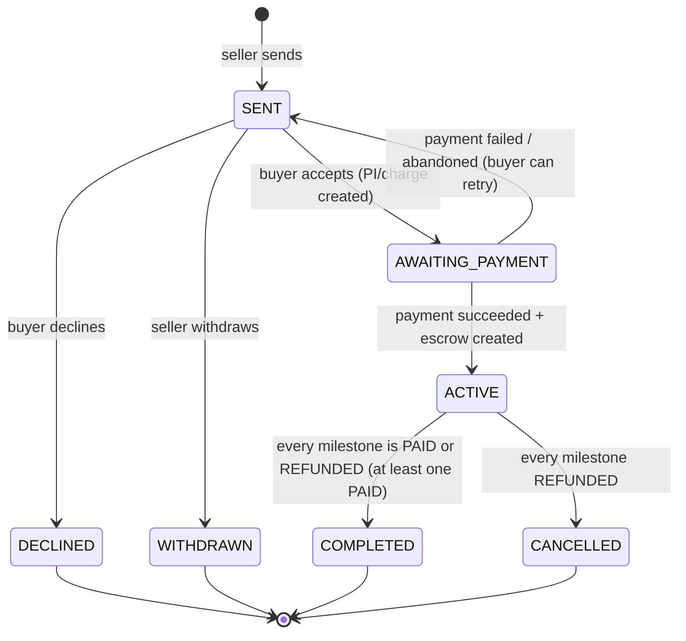
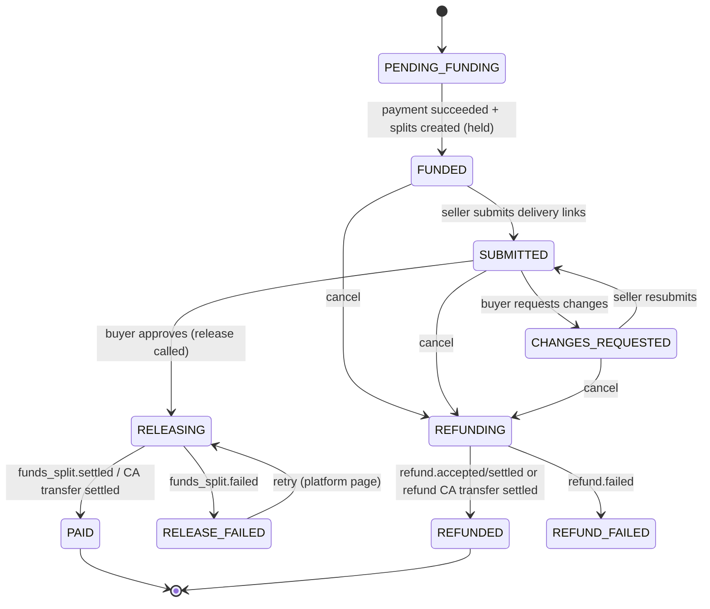

# 04 — Data Model (MongoDB)

All amounts are **integer minor units** (`amountMinor`) plus a `currency` code. Timestamps use Mongoose `timestamps: true` (`createdAt`, `updatedAt`).

## Collections overview

| Collection | Purpose |
| --- | --- |
| `users` | App users, credentials, their Airwallex connected account, provisioning state. |
| `offers` | Offers/contracts with **embedded milestones**, fee snapshot, and escrow references. |
| `payments` | One doc per funding attempt (card PaymentIntent or wallet Charge). |
| `webhook_events` | Every received Airwallex webhook (raw), for idempotency and the activity panel. |
| `airwallex_logs` | Every outbound Airwallex API call (redacted), for the activity panel and debugging. |
| `activity` | Human-readable timeline entries per offer ("Sam approved Milestone 2"). |
| `platform_settings` | Singleton: Revenue CA ID, seed version, guest pool, and similar. |

Milestones are **embedded** in offers because they are always read and written with their offer, there are few per offer (at most 10), and embedding lets us update offer and milestone status in one atomic write.

## `users`

```ts
{
  _id: ObjectId,
  email: string,               // unique, lowercased
  passwordHash: string,        // bcrypt
  name: string,
  headline?: string,           // "Brand designer", shown on offers
  avatarColor: string,         // cheap avatar
  kind: 'REGULAR' | 'SEED' | 'REVENUE',   // REVENUE = the platform revenue account holder (no login)
  isGuestPool: boolean,        // DEMO-ONLY: may be handed out by "Continue as guest"
  airwallex: {
    accountId?: string,        // acct_...
    accountStatus?: 'CREATED' | 'SUBMITTED' | 'ACTIVE' | 'ACTION_REQUIRED' | 'SUSPENDED',
    provisioning: {
      step: 'NONE' | 'ACCOUNT_CREATED' | 'SUBMITTED' | 'ACTIVE' | 'WELCOME_CREDITED' | 'READY' | 'FAILED',
      lastError?: string,
      updatedAt: Date,
    },
  },
  createdAt, updatedAt,
}
```

Indexes: `{ email: 1 }` unique; `{ 'airwallex.accountId': 1 }` unique sparse; `{ isGuestPool: 1 }`.

## `offers`

```ts
{
  _id: ObjectId,
  shortRef: string,            // "OF-7K2Q", human-friendly, used in Airwallex `reference`
  sellerId: ObjectId,          // ref users
  buyerId: ObjectId,           // ref users
  title: string,
  description: string,
  currency: 'USD',
  totalMinor: number,          // sum of milestone amounts
  status: OfferStatus,         // see state machine
  fundingRail?: 'CARD' | 'WALLET',
  feeSnapshot: {               // copied from config when SENT; never recomputed
    platformFeePercent: number,
    processingReservePercent: number,
  },
  paymentId?: ObjectId,        // successful funding payment
  isWelcomeOffer: boolean,     // created by provisioning for new users
  milestones: Milestone[],
  sentAt?: Date, acceptedAt?: Date, fundedAt?: Date, completedAt?: Date, closedAt?: Date,
  createdAt, updatedAt,
}

type Milestone = {
  _id: ObjectId,
  index: number,               // 0-based display order
  title: string,
  description?: string,
  dueDate?: Date,
  amountMinor: number,
  breakdown: { sellerMinor: number, revenueMinor: number, reserveMinor: number },
  status: MilestoneStatus,     // see state machine
  deliveries: Array<{
    _id: ObjectId,
    links: string[],           // URLs only, no files
    note?: string,
    submittedAt: Date,
    review?: { decision: 'APPROVED' | 'CHANGES_REQUESTED', comment?: string, reviewedAt: Date },
  }>,
  escrow: {
    // card rail
    sellerSplit?: SplitRef,
    revenueSplit?: SplitRef,
    refund?: { refundId: string, status: 'RECEIVED' | 'ACCEPTED' | 'SETTLED' | 'FAILED' },
    // wallet rail
    sellerTransfer?: TransferRef,
    revenueTransfer?: TransferRef,
    refundTransfer?: TransferRef,
  },
  approvedAt?: Date, paidAt?: Date, refundedAt?: Date,
}

type SplitRef = {
  splitId: string,             // spt_...
  amountMinor: number,
  destination: string,         // acct_...
  status: 'CREATED' | 'RELEASED' | 'SETTLED' | 'FAILED',
  reversalId?: string,
  reversalStatus?: string,
}

type TransferRef = {
  transferId: string,          // CA transfer id
  amountMinor: number,
  destination: string,
  status: 'NEW' | 'PENDING' | 'SETTLED' | 'SUSPENDED' | 'FAILED',
}
```

Indexes: `{ buyerId: 1, status: 1, createdAt: -1 }`, `{ sellerId: 1, status: 1, createdAt: -1 }`, `{ shortRef: 1 }` unique, `{ 'milestones.escrow.sellerSplit.splitId': 1 }` sparse, `{ 'milestones.escrow.revenueSplit.splitId': 1 }` sparse (webhook lookup by split ID).

## `payments`

```ts
{
  _id: ObjectId,
  offerId: ObjectId,
  attempt: number,             // 1, 2, ... (used in request_id)
  rail: 'CARD' | 'WALLET',
  amountMinor: number,
  currency: string,
  // card
  paymentIntentId?: string,    // int_...
  clientSecret?: string,       // DEMO-ONLY: stored for re-rendering checkout. PROD: don't persist; re-fetch or recreate.
  // wallet
  chargeId?: string,
  status: 'PENDING' | 'SUCCEEDED' | 'FAILED' | 'CANCELLED',
  failureReason?: string,
  refundedMinor: number,       // running total of refunds against this payment
  createdAt, updatedAt,
}
```

Indexes: `{ paymentIntentId: 1 }` unique sparse, `{ chargeId: 1 }` unique sparse, `{ offerId: 1, attempt: 1 }` unique.

## `webhook_events`

```ts
{
  _id: ObjectId,
  eventId: string,             // Airwallex event `id`, unique
  name: string,                // e.g. "payment_intent.succeeded"
  accountId?: string,          // account the event belongs to
  objectId?: string,           // extracted id of data object (int_, spt_, rfd_, ...)
  payload: object,             // raw JSON
  signatureValid: boolean,
  processedAt?: Date,
  processingError?: string,
  relatedOfferId?: ObjectId,
  receivedAt: Date,
}
```

Indexes: `{ eventId: 1 }` **unique** (the idempotency guard), `{ relatedOfferId: 1, receivedAt: -1 }`, `{ receivedAt: -1 }` with an optional TTL of 30 days.

## `airwallex_logs`

```ts
{
  _id: ObjectId,
  method: string, path: string, onBehalfOf?: string,
  requestId?: string,
  requestBody?: object,        // redacted (no client_secret, no card data; we never see card data anyway)
  status: number,
  responseBody?: object,       // trimmed
  errorCode?: string,
  durationMs: number,
  relatedOfferId?: ObjectId, relatedMilestoneId?: ObjectId, relatedUserId?: ObjectId,
  createdAt: Date,
}
```

Indexes: `{ relatedOfferId: 1, createdAt: -1 }`, `{ createdAt: -1 }` with a TTL of 30 days.

## `activity`

```ts
{ _id, offerId, actorId?: ObjectId, type: string, message: string, meta?: object, createdAt }
```

Examples of `type`: `OFFER_SENT`, `OFFER_ACCEPTED`, `PAYMENT_SUCCEEDED`, `SPLITS_CREATED`, `DELIVERY_SUBMITTED`, `CHANGES_REQUESTED`, `MILESTONE_APPROVED`, `FUNDS_RELEASED`, `MILESTONE_PAID`, `MILESTONE_REFUNDED`, `OFFER_COMPLETED`.

## `platform_settings` (singleton, `_id: 'default'`)

```ts
{
  _id: 'default',
  revenueUserId: ObjectId,
  revenueAccountId: string,    // acct_... of the Revenue CA
  seedVersion: number,
  lastSeededAt: Date,
}
```

## State machines

### Offer



There's no `DRAFT` state: offers are created and sent in one step (demo simplicity). `AWAITING_PAYMENT` → `SENT` happens when the buyer abandons checkout (a "Cancel" button, or on the next visit if the PI is still unpaid) or on `payment_intent.payment_failed`.

### Milestone



Rules:

- **Only the buyer** can approve or request changes. **Only the seller** can submit deliveries.
- Either party can cancel an **unreleased** milestone (`FUNDED`/`SUBMITTED`/`CHANGES_REQUESTED`). `// DEMO-ONLY:` In production, a seller-side cancel would need buyer consent or dispute rules.
- Milestones can be delivered in **any order** (simpler). An optional `SEQUENTIAL_MILESTONES=true` flag can require the previous milestone to be `PAID` first.
- A milestone is `PAID` only when **both** its seller and revenue splits (or transfers) are settled. The seller split settling is what the UI calls "Seller paid".
- All transitions go through `src/services/escrow.ts` / `offers.ts` using **conditional updates** (`findOneAndUpdate({ _id, 'milestones._id': mId, 'milestones.status': expected }, ...)`). This prevents double-approval from double clicks or concurrent webhook plus return-page processing.
