# 12 — Implementation Plan

We build **UI-first**. The UI kit, domain components, and every screen are built against the **mock transport** ([14-frontend-architecture.md](./14-frontend-architecture.md#4-mock-transport-srclibapimock--ui-first-development)) using the API contract in [06-api-routes.md](./06-api-routes.md). Then the backend implements the same contract, and we switch the mocks off.

Two tracks:

- **Track U (UI, starts now):** needs no Mongo, no Airwallex, and no platform capabilities from Airwallex.
- **Track B (backend):** starts after the contract is frozen (U6). The **B0 sandbox spike can run in parallel** with Track U at any time, because it only depends on Airwallex access ([R1](./13-open-questions-and-risks.md)).

Each phase ends with something demoable and is committed in small Conventional Commits (see `AGENTS.md`).

```mermaid
flowchart LR
  U0[U0 Scaffold] --> U1[U1 UI kit primitives] --> U2[U2 Contracts + pure domain] --> U3[U3 API lib + mocks + hooks] --> U4[U4 Domain components] --> U5[U5 Screens on mocks] --> U6[U6 Polish + contract freeze]
  P0[B0 Sandbox spike] -.parallel.-> U3
  U6 --> B1[B1 DB + auth] --> B2[B2 Airwallex client + provisioning + seed users] --> B3[B3 Offers] --> B4[B4 Card funding + webhooks] --> B5[B5 Release] --> B6[B6 Refunds] --> B7[B7 Wallet rail + seeded contracts + platform] --> B8[B8 Mocks off + deploy]
```

---

## Track U — UI first

### U0 — Scaffold

- `create-next-app` (TypeScript, App Router, Tailwind v4, ESLint, `src/`, import alias `@/*`).
- `shadcn` init (neutral base, CSS variables), then override tokens per [09 §2](./09-ui-pages.md#2-design-tokens-srcappglobalscss).
- Dependencies: `@tanstack/react-query`, `@tanstack/react-query-devtools`, `react-hook-form`, `@hookform/resolvers`, `zod`, `sonner`, `lucide-react`, `clsx`, `tailwind-merge`, `class-variance-authority`. Dev: `vitest`, `@testing-library/react`, `jsdom`, `tsx`.
- `src/app/providers.tsx` (QueryClientProvider, Toaster, devtools in dev), `src/lib/config.public.ts` (zod-validated `NEXT_PUBLIC_*` env).
- `.env.example` with `NEXT_PUBLIC_API_MOCKS=true`, `NEXT_PUBLIC_ENABLE_UI_KIT`, and the backend vars from [02](./02-architecture.md#environment-variables) (unused for now).
- npm scripts: `dev`, `build`, `lint`, `typecheck`, `test`. Fill in the real npm script names in `AGENTS.md` if they differ from the planned ones.

**Demo:** blank app runs; `npm run typecheck && npm run lint && npm run test` pass.

### U1 — UI kit primitives + `/dev/ui-kit`

- Add shadcn primitives and our own primitives from [09 §3](./09-ui-pages.md#primitives-srccomponentsui) (`MoneyInput`, `CopyButton`, `JsonViewer`, `EmptyState`, `ErrorState`, `Stepper`, `Timeline`, `KeyValueList`, ...).
- `/dev/ui-kit` page with tokens + primitives sections, left nav, theme (light/dark/system), viewer, and width controls.

**Demo:** `/dev/ui-kit` shows every primitive in every variant/state.

### U2 — Contracts + pure domain logic

- `src/contracts/*`: zod schemas and inferred DTO types for everything in [06](./06-api-routes.md), plus input schemas (`CreateOfferInputSchema`, ...).
- `src/contracts/permissions.ts`: `offerActions()` / `milestoneActions()` implementing the state machines and role rules in [04](./04-data-model.md#state-machines).
- `src/lib/money.ts` (minor-unit helpers, formatting) and `src/services/fees.ts` (pure `breakdown`).
- Unit tests: fees (rounding, sums, zero reserve), money, permissions (every status × role).

**Demo:** tests green; the contract exists as code.

### U3 — API library + mock transport + hooks

- `src/lib/api/*` (one function per route), `http.ts` transport, `ApiError`.
- `src/lib/api/mock/*`: router, in-memory DB persisted to `localStorage`, **fixtures mirroring [08-seeding.md](./08-seeding.md)** (same personas and offers), handlers for every route, `simulate.ts` for delayed money transitions, scenarios, error injection.
- `src/hooks/*`: query keys + every hook in [14 §3](./14-frontend-architecture.md#hook-inventory), including `useOfferSync`.
- `MockDevtools` floating panel (switch user, scenario, reset, latency, "fire webhook now").
- Tests: mock handlers follow the state machines (invalid transitions return 409); hook tests against the mock transport.

**Demo:** in the browser console / a scratch page, calling hooks returns realistic data; devtools switch users.

### U4 — Domain components

- All domain components in [09 §3](./09-ui-pages.md#domain-components-srccomponentsdomain), rendered from fixtures on `/dev/ui-kit`, including the full `MilestoneCard` status × role matrix and `AirwallexActivityPanel` with fake API-call and webhook rows.
- Layout components (`AppShell`, `TopBar`, `DemoBanner`, `PageHeader`).

**Demo:** the kit page shows the complete visual language of the app.

### U5 — Screens on mocks

Build every page from [09 §5](./09-ui-pages.md#5-pages) against hooks + mocks, in this order:

1. `/login`, `/signup`, `/welcome` (mock provisioning steps tick with delays)
2. `/` home
3. `/offers/new`
4. `/offers/[id]` (all role/status combinations via devtools user switching)
5. `/offers/[id]/pay` + `/pay/return` (`MockCardForm`, wallet tab)
6. `/wallet`
7. `/platform`

**Demo:** the full demo script from [11 §4](./11-setup-and-runbook.md#4-demo-script-about-5-minutes) runs end to end **on mocks**: accept, pay, deliver, approve, paid, cancel, refunded.

### U6 — Polish + contract freeze

Contract frozen in [06](./06-api-routes.md) on 2026-09-26. The routes the UI calls match `src/lib/api` and `src/contracts`.

- Loading/empty/error states everywhere; keyboard and focus pass; responsiveness pass at 375, 768, and 1024 ([09](./09-ui-pages.md#responsiveness)); light and dark theme switch with a full dark token set ([09](./09-ui-pages.md#themes)); copy pass ([09 §6](./09-ui-pages.md#6-copy-guidelines)).
- Review [06](./06-api-routes.md) against what the UI actually needed. Update `src/contracts` + docs for any change, then **freeze** the contract. After this, contract changes need a doc update in the same commit.
- Optional: deploy a **UI preview** (Vercel, `NEXT_PUBLIC_API_MOCKS=true`, `ALLOW_MOCKS_IN_PROD=true`) to share the look and feel.

**Demo:** clickable product on mock data; stakeholders sign off on UX before backend work.

---

## Track B — Backend

Each phase implements routes to the frozen contract, so the UI needs no changes. Verify by running the app with `NEXT_PUBLIC_API_MOCKS=false`. The mock switch is global, so incomplete backend areas will show errors in real mode until their phase lands. Keep developing UI in mock mode meanwhile.

### B0 — Sandbox spike (scripts only, can run in parallel with Track U)

Small standalone `tsx` scripts in `scripts/spike/`, sharing the real `src/lib/airwallex` client so the client gets built and tested here. Each prints results and writes raw responses to `scripts/spike/out/*.json`.

| Script | Verifies | Answers risk |
| --- | --- | --- |
| `01-auth.ts` | Login, token `expires_at`, API version header | R8 |
| `02-connected-account.ts` | `accounts/create` payload; `submit`; `simulation/update_status` → `ACTIVE`. The working payload is `BUSINESS` (see [03 §7](./03-airwallex-integration.md#7-connected-account-provisioning)) | R1, R2 |
| `03-balances-and-ca-transfer.ts` | CA Transfer platform → CA; `balances/current` + `history` with `x-on-behalf-of` | R6 |
| `04-charge.ts` | Charge CA → platform; `source` accepts `acct_...`; any authorization prerequisites | R5 |
| `05-payment-intent.ts` | Create a PaymentIntent (omit `connected_account_id` on this sandbox); print `client_secret`. Then pay it by hand via `scripts/spike/checkout.html` | R3 |
| `06-funds-split-held.ts` | After a PI succeeds: create 2 splits with `auto_release: false`; confirm status `CREATED`; wait N minutes/hours; release one; observe `RELEASED` → `SETTLED` and the destination balance increase | R3, R4 |
| `07-reversal-and-refund.ts` | On an unreleased split: create reversal, then partial refund. On a released split: reversal behaviour | R7 |
| `08-webhooks.ts` | Run a tiny server + tunnel; log real payloads for each subscribed event; verify signatures | R9 |

**Exit criteria:** a short `scripts/spike/FINDINGS.md` that resolves each risk in [13](./13-open-questions-and-risks.md) with the observed behaviour, and any doc updates. **If held splits don't work**, switch the default funding rail to wallet and keep the card rail as "payment acceptance + immediate split" (see fallback in 13). Findings that change DTOs (for example new statuses) go through the contract-change rule.

### B1 — DB + auth

- `src/lib/config.ts` (server env), `src/lib/db.ts`, Mongoose models from [04](./04-data-model.md).
- `src/server/http.ts` (`route()` wrapper: session, zod, error mapping), `src/server/dto/*` mappers using `src/contracts/permissions.ts`.
- Routes: `config/public`, `auth/*`, `me`, `auth/demo-accounts`, `users/search`. Proxy redirect in real mode (`src/proxy.ts`; Next.js 16 renamed middleware).

**Demo (real mode):** sign up and log in against Mongo; empty home page.

### B2 — Airwallex client, provisioning, seed users

- `src/lib/airwallex/*` + `airwallex_logs` logging; `services/provisioning.ts`; `POST /api/me/provisioning`.
- `scripts/seed.ts` users portion: one `BUSINESS` Revenue CA (service fee, no login, no welcome credit) and one `BUSINESS` CA per seed user (8), each via `services/provisioning.ts` and `scripts/seed-data/identity-fixture.ts`. `scripts/reset.ts` does not delete Airwallex accounts.
- `GET /api/wallet` (balances) so the `WalletChip` works.

**Demo:** sign up and see a real `acct_...` with a $5,000 balance. Guest login works.

### B3 — Offers (no money)

- `services/offers.ts`: create/send, decline, withdraw, deliveries, request changes; welcome offer at the end of provisioning.
- Routes: `offers` list/create/get, decline, withdraw, deliveries, request-changes, activity.

**Demo:** send offers between real users.

### B4 — Card funding + webhooks

- `services/funding.ts` card rail; routes `payments/card`, `payments/reconcile`, `payments/cancel`.
- `DropInCheckout` in real mode (replaces `MockCardForm`).
- Webhook route, `webhook_events`, dispatcher; `escrow.onFundingSucceeded` creating held splits.
- `POST /offers/:id/sync`, `GET /offers/:id/airwallex-events`.

**Demo:** buyer pays by card; milestones show "Held in escrow" with real `spt_` IDs.

### B5 — Approval and release

- `escrow.approveMilestone`, `funds_split.*` handlers, `maybeMarkPaid`, offer completion; `approve` + `retry` routes.
- `GET /api/wallet/transactions`.

**Demo:** full happy path; seller balance and Revenue account increase.

### B6 — Cancellation and refunds

- `escrow.refundMilestone` / `cancelRemaining`; `refund.*` handlers; `cancel` + `cancel-remaining` routes.

**Demo:** cancel a milestone; buyer refunded.

### B7 — Wallet rail, seeded contracts, platform

- `payments/wallet`, wallet-rail release/refund via CA Transfers, charge/transfer handlers.
- Seed offers in all states (wallet rail).
- `platform/overview`, `platform/webhooks`.

**Demo:** log in as guest and see a rich, pre-populated dashboard backed by real sandbox data.

### B8 — Mocks off + deploy

- Run the full demo script with `NEXT_PUBLIC_API_MOCKS=false`.
- Stretch: withdraw to bank; send to user; `SEQUENTIAL_MILESTONES` flag.
- Deploy to Vercel + Atlas; register the webhook; run seed; rehearse.
- Audit: `rg "DEMO-ONLY:"` matches the inventory in [10](./10-demo-vs-production.md).

---

## Testing strategy

| Layer | What | How |
| --- | --- | --- |
| Pure logic | `fees.breakdown`, money conversion, `permissions.ts`, status rank / transition guards, request ID builders | Vitest unit tests |
| Mock transport | Handlers obey the state machines and return contract-valid DTOs | Vitest (latency 0) with zod response validation |
| Hooks | Query/mutation behaviour, cache updates, `useOfferSync` stop conditions | Vitest + RTL against the mock transport |
| Components | Visual review on `/dev/ui-kit`; RTL tests for `MilestoneCard` action rendering | Manual + Vitest |
| Webhook | Signature verification (known vector), idempotency (duplicate event), out-of-order events | Vitest with an in-memory Mongo (`mongodb-memory-server`) |
| Services | Escrow transitions with a mocked Airwallex client | Vitest |
| Contract parity | Route handlers return the same DTO shapes as mocks | Response zod validation in dev + optional hook tests against the real transport |
| End to end | Happy path + refund against the real sandbox | Manual script in the runbook; optional Playwright later |

## Definition of done (demo)

- All flows in [05](./05-user-flows.md) work against the sandbox, with and without a webhook tunnel.
- The same flows work in mock mode (for UI development and previews).
- Seed + reset are reliable and idempotent.
- Every shortcut is tagged and listed.
- The demo script in [11](./11-setup-and-runbook.md#4-demo-script-about-5-minutes) runs cleanly from a fresh seed.
