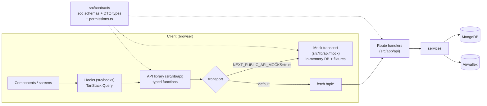

# 14 — Frontend Architecture (API library, React Query, state, mocks)

How the UI gets data, where state lives, and how we build the whole UI **before** the backend exists.



## 1. Layers and rules

| Layer | Location | May import | Must not |
| --- | --- | --- | --- |
| Contracts | `src/contracts/*` | `zod` only | Import anything from `server/`, `services/`, `models/`, React |
| API library | `src/lib/api/*` | contracts | Use React, touch the DOM, or know about Query |
| Mock transport | `src/lib/api/mock/*` | contracts, `src/lib/money.ts`, `src/services/fees.ts` (pure) | Import Mongoose, Airwallex, or `server/` |
| Hooks | `src/hooks/*` | API library, contracts, TanStack Query | Call `fetch` directly |
| Components | `src/components/**` | hooks, contracts (types), UI kit | Call the API library directly (go through hooks), call `fetch` |
| Pages | `src/app/**/page.tsx` | screen components | Fetch data (see §6) |

`src/services/fees.ts` must stay **pure** (no DB, no env access; config passed in) so the mock and the `FeeBreakdown` component can use the exact same math as the server.

## 2. API library (`src/lib/api`)

```text
src/lib/api/
├── index.ts          # export const api = { auth, me, config, users, offers, milestones, payments, wallet, platform }
├── transport.ts      # Transport interface + getTransport() (fetch or mock)
├── http.ts           # fetch transport: JSON, credentials, ErrorDTO → ApiError
├── errors.ts         # class ApiError { status, code, message, fieldErrors, airwallex }
├── auth.ts           # signup, login, guest, logout, demoAccounts
├── me.ts             # get, runProvisioning
├── config.ts         # getPublic
├── users.ts          # search
├── offers.ts         # list, get, create, decline, withdraw, cancelRemaining, sync, activity, airwallexEvents
├── milestones.ts     # submitDelivery, requestChanges, approve, cancel, retry
├── payments.ts       # startCard, reconcile, cancel, payFromWallet
├── wallet.ts         # get, transactions, withdraw, send
├── platform.ts       # overview, webhooks, unlock
└── mock/             # see §4
```

One function per route in [06-api-routes.md](./06-api-routes.md). Functions are thin and typed:

```ts
// src/lib/api/milestones.ts
import type { OfferDTO } from '@/contracts/offers';
import { request } from './transport';

export const milestones = {
  approve: (offerId: string, milestoneId: string) =>
    request<OfferDTO>('POST', `/api/offers/${offerId}/milestones/${milestoneId}/approve`),
  submitDelivery: (offerId: string, milestoneId: string, body: SubmitDeliveryInput) =>
    request<OfferDTO>('POST', `/api/offers/${offerId}/milestones/${milestoneId}/deliveries`, body),
};
```

```ts
// src/lib/api/transport.ts
export interface Transport {
  request<T>(method: 'GET' | 'POST', path: string, body?: unknown, query?: Record<string, string | undefined>): Promise<T>;
}
export const request: Transport['request'] = (...args) => getTransport().request(...args);
```

- `http.ts` sends `credentials: 'same-origin'` and parses JSON. On non-2xx, it throws `ApiError` built from `ErrorDTO`. A network failure throws `ApiError { code: 'NETWORK' }`.
- **Dev-only response validation:** in development, parse responses with the zod schema from `src/contracts` and `console.warn` on mismatch. This catches mock/real drift early. Skip it in production.
- The API library is also usable from scripts and tests; that's why it's framework-free.

## 3. TanStack Query hooks (`src/hooks`)

Package: `@tanstack/react-query` (+ `@tanstack/react-query-devtools` in dev). A single `QueryClientProvider` lives in `src/app/providers.tsx`.

### Defaults

```ts
new QueryClient({
  defaultOptions: {
    queries: { staleTime: 15_000, retry: (n, err) => !(err instanceof ApiError && err.status < 500) && n < 2, refetchOnWindowFocus: true },
    mutations: { retry: false },
  },
});
```

- Global `onError` for **queries** with `401`: clear the cache and redirect to `/login`.
- Mutations surface errors via toast by default (`meta: { toastError: true }`); forms map `fieldErrors` to fields instead.

### Query keys (`src/hooks/queryKeys.ts`)

```ts
export const qk = {
  config:        ['config'] as const,
  me:            ['me'] as const,
  demoAccounts:  ['demo-accounts'] as const,
  userSearch:    (q: string) => ['users', 'search', q] as const,
  offers:        ['offers'] as const,                                   // prefix for invalidation
  offerList:     (view: OfferView) => ['offers', 'list', view] as const,
  offer:         (id: string) => ['offers', 'detail', id] as const,
  offerActivity: (id: string) => ['offers', 'detail', id, 'activity'] as const,
  offerAwxEvents:(id: string) => ['offers', 'detail', id, 'airwallex-events'] as const,
  wallet:        ['wallet'] as const,
  walletTx:      ['wallet', 'transactions'] as const,
  platform:      ['platform'] as const,
  platformWebhooks: ['platform', 'webhooks'] as const,
};
```

### Hook inventory

| Hook | Wraps | Notes |
| --- | --- | --- |
| `usePublicConfig()` | `api.config.getPublic` | `staleTime: Infinity` |
| `useMe()` | `api.me.get` | Returns `null` on 401 (no throw). Source of truth for "am I logged in". |
| `useDemoAccounts()` | `api.auth.demoAccounts` | |
| `useSignup()`, `useLogin()`, `useGuestLogin()`, `useLogout()` | `api.auth.*` | On success: `setQueryData(qk.me, me)`, then `router.replace(...)`. Logout: `queryClient.clear()`. |
| `useRunProvisioning()` | `api.me.runProvisioning` | `/welcome` fires it once; `useMe({ refetchInterval: 1500 })` while `step` isn't `READY`/`FAILED`. |
| `useUserSearch(q)` | `api.users.search` | `enabled: q.length >= 2`, debounced input, `placeholderData: keepPreviousData`. |
| `useOffers(view)` | `api.offers.list` | |
| `useOffer(id)` | `api.offers.get` | |
| `useOfferActivity(id)`, `useOfferAirwallexEvents(id, { enabled })` | | Events panel fetches only when expanded. |
| `useCreateOffer()` | `api.offers.create` | Success: `setQueryData(qk.offer(id))`, invalidate `qk.offers` list keys, navigate. |
| `useOfferAction(id)` | decline / withdraw / cancelRemaining | Returns `{ decline, withdraw, cancelRemaining }` mutations. |
| `useMilestoneAction(offerId)` | submitDelivery / requestChanges / approve / cancel / retry | See "mutation pattern". |
| `useStartCardPayment(offerId)` | `api.payments.startCard` | Returns the session for the Drop-in. |
| `useReconcilePayment(offerId)` | `api.payments.reconcile` | Called on the return page. |
| `useCancelPayment(offerId)`, `usePayFromWallet(offerId)` | | |
| `useOfferSync(offerId)` | `api.offers.sync` | Auto-polling, see below. |
| `useWallet()`, `useWalletTransactions()` | | `useInfiniteQuery` for transactions (cursor). |
| `usePlatformOverview()`, `usePlatformWebhooks()` | | `refetchInterval: 5000` on `/platform`. |
| `useUnlockPlatform()` | `api.platform.unlock` | Sets the demo admin cookie, then `router.refresh()` so the gate re-renders as `PlatformScreen`. |

### Mutation pattern

Every offer/milestone mutation returns the updated `OfferDTO`:

```ts
export function useMilestoneAction(offerId: string) {
  const qc = useQueryClient();
  const onSuccess = (offer: OfferDTO) => {
    qc.setQueryData(qk.offer(offerId), offer);            // instant, no refetch
    qc.invalidateQueries({ queryKey: ['offers', 'list'] }); // home page cards
    qc.invalidateQueries({ queryKey: qk.offerActivity(offerId) });
    qc.invalidateQueries({ queryKey: qk.offerAwxEvents(offerId) });
  };
  return {
    approve: useMutation({ mutationFn: (mid: string) => api.milestones.approve(offerId, mid), onSuccess }),
    // submitDelivery, requestChanges, cancel, retry ... same onSuccess
  };
}
```

- **No optimistic updates for money actions** (pay, approve, cancel/refund, retry). The server response already carries the honest intermediate state (`RELEASING`, `REFUNDING`), and faking success would contradict the milestone state.
- Optimistic updates are allowed for non-money actions if they feel slow (for example request changes), but they aren't needed initially.
- When a money action settles (a milestone becomes `PAID` or `REFUNDED`), also invalidate `qk.wallet`.

### Pending-state polling (`useOfferSync`)

```ts
export function useOfferSync(offerId: string, offer?: OfferDTO) {
  // While a payment, release, or refund is still in flight: POST /sync every 3s.
  // Stop that poll after 60s (expose `timedOut` so the UI shows "Still waiting… Sync now").
  // A card milestone whose splits are already RELEASED syncs once on open, then only when Sync is pressed.
  // When pending → not pending: invalidate lists, activity, airwallex-events, wallet.
}
```

Implement with `useQuery` writing the result into `qk.offer(id)`. Fast `refetchInterval: 3000` applies only while something is still in flight. The manual **Sync** button calls the same endpoint via `useMutation`.

## 4. Mock transport (`src/lib/api/mock`) — UI-first development

With `NEXT_PUBLIC_API_MOCKS=true`, `getTransport()` returns the mock transport. The UI is fully clickable with **no Mongo, no Airwallex, and no route handlers**. The real routes can be built later behind the same contract.

```text
src/lib/api/mock/
├── index.ts          # mockTransport: routes method+path to a handler, adds latency, throws ApiError
├── router.ts         # tiny path matcher: 'POST /api/offers/:id/milestones/:mid/approve'
├── db.ts             # in-memory store (users, offers, wallets, activity, awx events); persisted to localStorage
├── fixtures.ts       # seed personas + offers mirroring docs/08-seeding.md
├── actions.ts        # route behaviour from docs/06, one function per route
├── simulate.ts       # delayed "webhooks": RELEASING → PAID after ~2.5s, etc.
└── scenarios.ts      # named states: 'fresh-seed', 'empty-new-user', 'everything-pending', 'errors'
```

Behaviour:

- **Same DTOs and status codes** as the real API, validated against `src/contracts` in dev.
- **Same rules:** uses `src/contracts/permissions.ts` for `allowedActions`, `src/services/fees.ts` for breakdowns, and the state machines in [04](./04-data-model.md). Invalid transitions return `409 INVALID_STATE`, just like the backend.
- **Realistic latency:** 250–700ms random per call (configurable; `0` in tests).
- **Simulated async money:** approve → `RELEASING`. A card release marks its funds-split legs `RELEASED` immediately (the calm Released state), then after ~2.5s `simulate.ts` flips the milestone to `PAID`. Wallet releases keep the spinner until that jump. Cancel → `REFUNDING` → `REFUNDED`. Wallet payment → `AWAITING_PAYMENT` → `ACTIVE`. `POST /sync` just returns current state, which exercises `useOfferSync` for real.
- **Mock session:** `login`/`guest` store the current mock user ID in `localStorage`; `GET /api/me` returns it or a 401.
- **Mock checkout:** in mock mode, the pay page renders `MockCardForm` (looks like the Drop-in) instead of `@airwallex/components-sdk`. Card `4035 5010 0000 0008` succeeds; `4012 0003 0000 1003` declines. On success it navigates to the real return page, which calls `reconcile`.
- **Error injection:** `scenarios.ts` can make the next N calls to a route fail (for example `AIRWALLEX_ERROR` on approve) to build error states.
- **Mock devtools:** a small floating panel (only when mocks are on): switch user, pick a scenario, reset mock DB, set latency, fire "webhook now" for pending items.

`// DEMO-ONLY:` The mock transport is a development tool. It must never be enabled in a deployed build: `src/lib/config.public.ts` throws if `NEXT_PUBLIC_API_MOCKS=true` and `NODE_ENV=production`, unless `ALLOW_MOCKS_IN_PROD=true` is set explicitly for a UI preview deployment. `// PROD:` Remove mocks from production bundles (dynamic import behind the flag, so they're tree-shaken).

**Why a custom mock transport instead of MSW?** It needs no service worker setup in the App Router, works identically in tests and Storybook-less demo pages, and can share pure domain code (fees, permissions) directly. MSW is a fine alternative if we later want network-level mocking; the API library wouldn't change.

## 5. State management

**No global client store** (no Redux, and no Zustand to start). Each kind of state has one home:

| State | Home | Examples |
| --- | --- | --- |
| **Server state** | TanStack Query cache **only** | me, offers, wallet, config. Never copy query data into `useState` or context. Derive in render. |
| **URL state** | Route params + `searchParams` | Offer ID, home tab (`?tab=selling`), pay tab (`?method=wallet`), UI kit section anchors |
| **Form state** | `react-hook-form` + `@hookform/resolvers/zod` using schemas from `src/contracts` | Create offer (with `useFieldArray` for milestones), delivery form, login/signup |
| **Local UI state** | `useState` / `useReducer` in the component | Dialog open, panel expanded, copy-to-clipboard feedback |
| **Persisted UI prefs** | Small `useLocalStorage` hook | Demo banner dismissed, activity panel default open |
| **Toasts** | `sonner` (`toast.success/error`) | Mutation results |

If a genuinely cross-cutting **client-only** state appears (for example a global "demo presenter mode"), add a tiny React context in `src/components/providers/`. Reach for Zustand only if a context causes real re-render problems, and document it here first.

## 6. Rendering model

- Pages (`src/app/**/page.tsx`) are thin Server Components that render one **client screen** component (`src/components/screens/OfferScreen.tsx`, etc.). Screens fetch through hooks.
- We deliberately **don't fetch data in Server Components**. There's one data path (API library → hooks), and it works identically with mocks. That trade-off (no SSR data, loading skeletons on first paint) is fine for a demo.
- **Auth gating:** `src/proxy.ts` redirects to `/login` when the session cookie is missing, **only in real mode**. Next.js 16 renamed middleware to proxy. In mock mode, `AppShell` uses `useMe()` and redirects client-side. Provisioning gating (`step !== 'READY'` → `/welcome`) is always client-side in `AppShell`.
- Route groups: `(public)` for login/signup, `(app)` for authenticated pages with `AppShell`, `dev/` for the UI kit.

## 7. Forms and validation

- One zod schema per input in `src/contracts` (for example `CreateOfferInputSchema`). The **same schema** validates on the client (RHF resolver), in the mock handler, and in the route handler.
- Server `fieldErrors` (422) map back onto RHF with `setError(path, { message })`. Paths use dot notation (`milestones.2.amount`).
- Money inputs: a `MoneyInput` component keeps the raw decimal string, validates with a regex (`^\d+(\.\d{1,2})?$`), and shows a formatted preview. Convert to minor units only for the live `FeeBreakdown`, using `src/lib/money.ts`.

## 8. Testing the frontend

| What | How |
| --- | --- |
| Contracts, permissions, fees, money | Vitest unit tests |
| Mock handlers (state machine parity with docs/04) | Vitest against `mockTransport` with latency `0` |
| Hooks | Vitest + `@testing-library/react` with a fresh `QueryClient` and the mock transport |
| Components | The `/dev/ui-kit` page (visual) + a few RTL tests for `MilestoneCard` action rendering |
| Mock ↔ real parity | Once routes exist, run the hook tests against the real transport with a seeded test DB (optional) |

## 9. Folder additions (summary)

```text
src/
├── contracts/            # zod schemas + DTO types + permissions.ts (shared)
├── lib/api/              # API library + mock transport
├── hooks/                # TanStack Query hooks + queryKeys.ts
├── components/
│   ├── ui/               # UI kit primitives (shadcn/ui-based)
│   ├── domain/           # Money, StatusPill, FeeBreakdown, MilestoneCard, ...
│   ├── layout/           # AppShell, TopBar, DemoBanner, PageHeader
│   ├── screens/          # one client screen per page
│   └── providers/        # QueryProvider, Toaster, MockDevtools
├── server/               # route() wrapper, DTO mappers (server-only)
└── app/
    ├── (public)/login, signup
    ├── (app)/page.tsx, welcome, offers/..., wallet, platform
    ├── dev/ui-kit/page.tsx
    └── api/...
```
